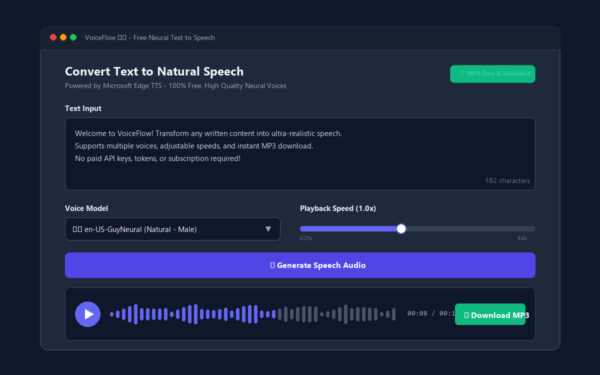

# VoiceFlow 🎙️

<p align="center">
  <strong>High-Quality, Natural AI Text-to-Speech Web Application — 100% Free & Unlimited</strong>
</p>

<p align="center">
  <a href="https://github.com/NO-NEED-NAME/VoiceFlow/releases/latest">
    
  </a>
  <a href="https://github.com/NO-NEED-NAME/VoiceFlow/actions/workflows/ci.yml">
    
  </a>
  
  
  
  
</p>

---

VoiceFlow is a modern, full-stack Text-to-Speech (TTS) application that converts text into natural-sounding speech completely for **FREE**. 

It harnesses **Microsoft Edge TTS** neural voice models to generate high-fidelity audio without requiring paid subscriptions, credit cards, or costly third-party API keys (such as OpenAI or ElevenLabs).

---

## 📸 Interface Preview

<p align="center">
  
</p>

---

## 📦 Releases

You can download the latest stable release archive directly from GitHub:

- 🚀 **[Latest Stable Release (v1.0.0)](https://github.com/NO-NEED-NAME/VoiceFlow/releases/latest)**
- 📋 **[Release Notes & Changelog](https://github.com/NO-NEED-NAME/VoiceFlow/releases)**

---

## ✨ Features

- **100% Free & Unlimited:** No subscription, credit card, or proprietary API key required.
- **High-Quality Neural Voices:** Leverages Microsoft Edge's natural multi-lingual voice synthesis.
- **Dynamic Speed Control:** Adjust playback speech rate seamlessly from 0.25x up to 4.0x.
- **Modern & Responsive UI:** Clean glassmorphism/dark theme built with React and Tailwind CSS.
- **Instant Audio Player & Download:** Listen to the synthesized output right in your browser or export as MP3.
- **Dual-Stack Architecture:** Decoupled FastAPI backend and React frontend for optimal performance.

---

## 🛠️ Tech Stack

| Layer | Technologies |
| :--- | :--- |
| **Frontend** | React.js, Tailwind CSS, Lucide React, Axios |
| **Backend** | Python 3.9+, FastAPI, Edge-TTS, Motor (Async MongoDB Driver) |
| **Database** | MongoDB *(Optional — used for saving conversion history)* |
| **CI / CD** | GitHub Actions Workflow |

---

## 🚀 Installation & Getting Started

Follow the steps below to run VoiceFlow on your local machine.

### Prerequisites
- **Node.js** (v16.x or higher)
- **Python** (v3.9 or higher)
- **Git**

---

### 1. Backend Setup (API Server)

1. Open a terminal and navigate to the `backend` folder:
   ```bash
   cd backend
   ```

2. (Recommended) Create and activate a virtual environment:
   ```bash
   # Windows (PowerShell)
   python -m venv venv
   .\venv\Scripts\Activate.ps1

   # Linux / macOS
   python3 -m venv venv
   source venv/bin/activate
   ```

3. Install required Python packages:
   ```bash
   pip install -r requirements.txt
   ```

4. Create an environment configuration file `.env` inside `backend/` *(Optional if using default settings)*:
   ```env
   MONGO_URL=mongodb://localhost:27017
   DB_NAME=voiceflow_db
   CORS_ORIGINS=http://localhost:3000
   ```

5. Run the FastAPI development server:
   ```bash
   python server.py
   ```
   > The API will be available at: **http://localhost:8000** (API Docs at `http://localhost:8000/docs`)

---

### 2. Frontend Setup (React Client)

1. Open a new terminal window and navigate to the `frontend` folder:
   ```bash
   cd frontend
   ```

2. Install Node dependencies:
   ```bash
   npm install --legacy-peer-deps
   ```

   > **💡 Why is `--legacy-peer-deps` required?**
   > Starting from **npm v7+**, npm automatically resolves and enforces peer dependencies strictly. If any nested package specifies a peer dependency for an older React major version (for instance, older icon packages or Tailwind utilities expecting `react@^17.0.0` while the project uses `react@^18.0.0`), standard `npm install` halts with an `ERESOLVE unable to resolve dependency tree` error.
   > 
   > The `--legacy-peer-deps` flag instructs npm to revert to npm v4–v6 peer dependency resolution behavior, safely ignoring non-breaking transitive version discrepancies so installation finishes smoothly.
   > 
   > *Tip:* If you prefer running plain `npm install` without typing the flag each time, you can create a `.npmrc` file in your `frontend/` directory with:
   > ```ini
   > legacy-peer-deps=true
   > ```

3. Launch the development server:
   ```bash
   npm start
   ```
   > The application will open automatically in your browser at: **http://localhost:3000**

---

## 📝 How to Use

1. **Enter Text:** Paste or type the text you want converted into speech.
2. **Select Voice:** Choose your preferred neural voice (Male / Female, English or international accents).
3. **Adjust Speed:** Set the desired speech rate between 0.25x and 4.0x.
4. **Generate:** Click **⚡ Generate Speech**.
5. **Listen & Export:** Stream audio playback directly or click **⬇ Download MP3** to save the file.

---

## 🗺️ Roadmap & Active Development

VoiceFlow is actively maintained and expanding! Check out our open issues to see what's currently in progress:

- [x] v1.0.0 Initial release with Edge-TTS and React UI
- [ ] Pitch and volume modulation controls ([#1](https://github.com/NO-NEED-NAME/VoiceFlow/issues))
- [ ] Long-text automated sentence chunking and streaming ([#2](https://github.com/NO-NEED-NAME/VoiceFlow/issues))
- [ ] Persistent generation history drawer ([#3](https://github.com/NO-NEED-NAME/VoiceFlow/issues))
- [ ] Subtitle & SRT/VTT file export ([#4](https://github.com/NO-NEED-NAME/VoiceFlow/issues))
- [ ] Docker Compose containerization ([#5](https://github.com/NO-NEED-NAME/VoiceFlow/issues))

👉 **View all open issues or request a feature at [VoiceFlow Issues](https://github.com/NO-NEED-NAME/VoiceFlow/issues)**.

---

## 🤝 Contributing

Contributions, bug reports, and feature suggestions are welcome!
1. Fork the Project
2. Create your Feature Branch (`git checkout -b feature/AmazingFeature`)
3. Commit your Changes (`git commit -m 'Add some AmazingFeature'`)
4. Push to the Branch (`git push origin feature/AmazingFeature`)
5. Open a Pull Request

---

## 📄 License

Distributed under the **MIT License**. See `LICENSE` for more information.
